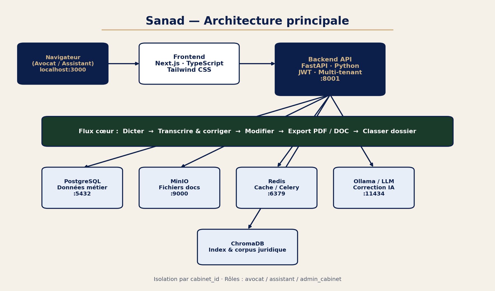
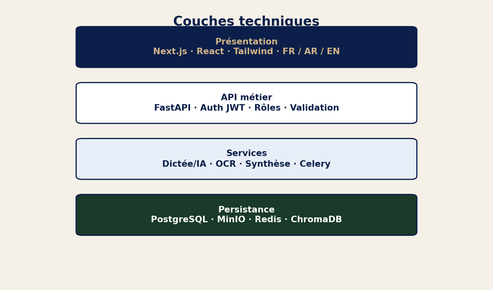
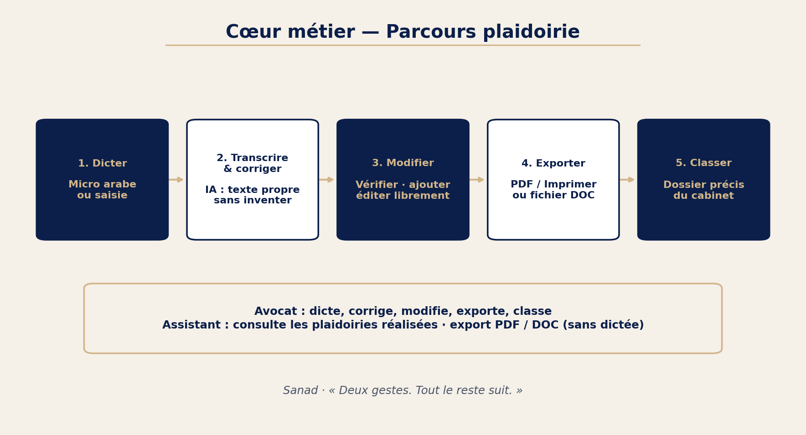
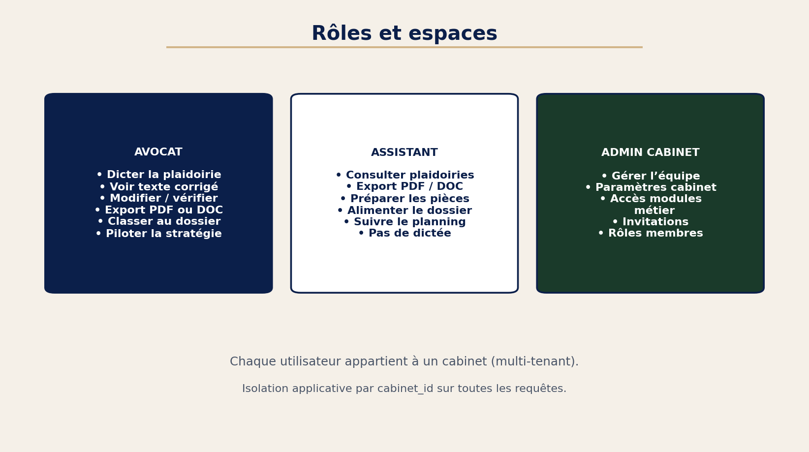
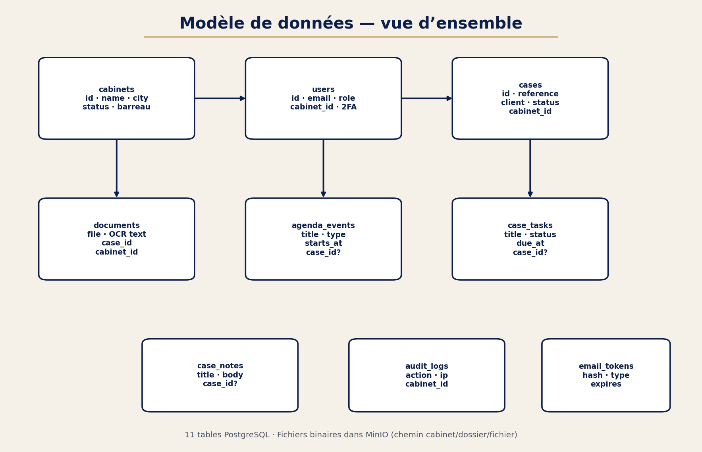

# Sanad — Document de conception

**Projet :** Plateforme d’Assistance en Intelligence Artificielle pour Avocats  
**Auteur :** Douae El Assal · ENSA Tétouan · Entreprise d’accueil : WebVoice  
**Type :** PFA — Document de conception (synthèse technique & métier)

---

## 1. Objet du document

Ce document décrit la conception de Sanad : besoin, solution, architecture, parcours métier, rôles, et choix techniques.  
Les schémas associés sont dans `docs/diagrammes/`.

---

## 2. Contexte et besoin

### 2.1 Problématique

Dans un cabinet d’avocats, le passage de la **parole** de l’avocat à un **document de plaidoirie** exploitable reste souvent manuel, lent, et peu intégré au dossier numérique.

Les outils du marché couvrent en général :
- la **gestion de cabinet**, ou  
- une **dictée isolée**, ou  
- une **IA juridique générale**,  

mais rarement le parcours complet jusqu’à un document **modifiable** et **exportable** (PDF / DOC), classé dans un dossier, avec collaboration avocat / assistant.

### 2.2 Objectif produit

Fournir une plateforme SaaS multi-cabinets dont le **cœur** est :

> **Dicter → Transcrire & corriger → Modifier → Exporter PDF ou DOC → Classer dans un dossier**

Message produit : *« Deux gestes. Tout le reste suit. »*

---

## 3. Périmètre fonctionnel

| Domaine | Contenu |
|---------|---------|
| Plaidoirie | Dictée, correction IA, édition, export PDF/DOC, archivage dossier |
| Dossiers | Création, suivi, rattachement pièces / événements |
| Documents | Upload, OCR, aperçu, synthèse (selon rôle) |
| Planning | Agenda, tâches, notes liés au dossier |
| Équipe | Invitations, rôles (admin cabinet) |
| Compte / sécurité | Auth, 2FA, isolation cabinet |
| Site public | Présentation, inscription, pages légales |

Hors menu principal (non mis en avant) : modèles de contrats, assistant IA global — le focus produit reste la plaidoirie.

---

## 4. Architecture système

### 4.1 Diagramme principal

### 4.2 Couches

| Couche | Technologie |
|--------|-------------|
| Présentation | Next.js, TypeScript, Tailwind CSS |
| API | Python, FastAPI, JWT |
| Services | Dictée / polish / compose, OCR, synthèse, Celery |
| Persistance | PostgreSQL, MinIO, Redis, ChromaDB |
| IA | Ollama local + fournisseurs cloud (config) |
| Déploiement | Docker Compose → VPS Debian (cible) |

### 4.3 Ports (dev)

| Service | Port |
|---------|------|
| Frontend | 3000 |
| Backend API | 8001 |
| PostgreSQL | 5432 |
| Redis | 6379 |
| MinIO | 9000 / 9001 |
| Ollama | 11434 |

---

## 5. Conception métier — parcours plaidoirie

| Étape | Acteur | Résultat |
|-------|--------|----------|
| 1. Dicter | Avocat | Texte brut (voix ou saisie) |
| 2. Transcrire & corriger | Système (IA) + avocat | Texte propre, éditable |
| 3. Modifier | Avocat | Document officiel vérifié |
| 4. Exporter | Avocat (ou assistant en lecture) | PDF / impression ou DOC |
| 5. Classer | Avocat | Fichier rattaché au dossier (MinIO + table `documents`) |

Principe : l’IA **accélère** ; l’avocat **valide et reste maître** du texte final.

---

## 6. Rôles et multi-tenant

| Rôle | Responsabilité principale |
|------|---------------------------|
| `avocat` | Produire la plaidoirie, piloter le dossier |
| `assistant_juridique` | Préparer pièces, consulter / exporter plaidoiries |
| `admin_cabinet` | Gérer équipe et paramètres du cabinet |
| `admin_webvoice` | Administration plateforme (cabinets, logs) |

**Isolation :** chaque entité métier porte un `cabinet_id`. Les requêtes API filtrent systématiquement sur le cabinet de l’utilisateur connecté.  
Stockage fichiers : `{cabinet_id}/{case_id}/{fichier}` dans MinIO.

---

## 7. Conception des données (aperçu)

Détail complet des tables et colonnes : voir **`03-base-de-donnees.md`**.

Entités centrales :
- `cabinets` → `users` → `cases` → `documents`
- Workspace : `agenda_events`, `case_tasks`, `case_notes`
- Sécurité : `email_tokens`, `audit_logs`

---

## 8. Conception des interfaces

Voir le document dédié **`01-interfaces-application.md`**.

Principes :
- Menu cabinet centré sur le cœur métier  
- Parcours plaidoirie en étapes visibles  
- Différenciation UI avocat / assistant  
- Multilingue FR / AR / EN  

---

## 9. Sécurité (conception)

| Mesure | Description |
|--------|-------------|
| Authentification | JWT (access + refresh), e-mail vérifié |
| Mot de passe | Hash (stockage `hashed_password`) |
| 2FA | TOTP optionnel |
| Isolation | Filtrage `cabinet_id` applicatif |
| Fichiers | Stockage objet MinIO, hors base relationnelle |
| Audit | Journal `audit_logs` (actions sensibles) |
| Cabinets | Statuts `pending` / `active` / `suspended` |

---

## 10. Choix techniques (justification courte)

| Choix | Pourquoi |
|-------|----------|
| Next.js | UI moderne, i18n, app cabinet + site public |
| FastAPI | API typée, rapide à itérer pour le PFA |
| PostgreSQL | Données relationnelles fiables (dossiers, users) |
| MinIO | Fichiers volumineux (PDF, pièces) |
| Redis + Celery | Traitements asynchrones (OCR / index) |
| Docker | Environnement reproductible + déploiement VPS |

---

## 11. État d’implémentation (conception vs réalisé)

| Élément | Statut |
|---------|--------|
| Architecture Docker + modules métier | En place |
| Parcours plaidoirie (dictée → export → dossier) | Première implémentation |
| Isolation cabinet / rôles | En place (à consolider) |
| Sécurité avancée / hardening | À renforcer |
| Déploiement VPS | En cours (accès SSH) |

---

## 12. Documents associés

| Document | Contenu |
|----------|---------|
| `01-interfaces-application.md` | Description des écrans |
| `03-base-de-donnees.md` | Tables, colonnes, stockage |
| `diagrammes/*.png` | Schémas pour présentation / rapport |
| `maquettes/*.png` | Captures d’écran UI |

---

*Sanad · Document de conception · PFA · ENSA Tétouan · WebVoice · Douae El Assal*
