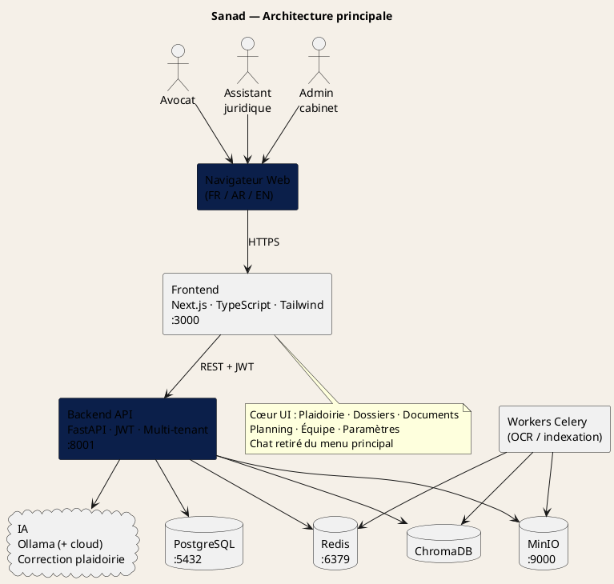
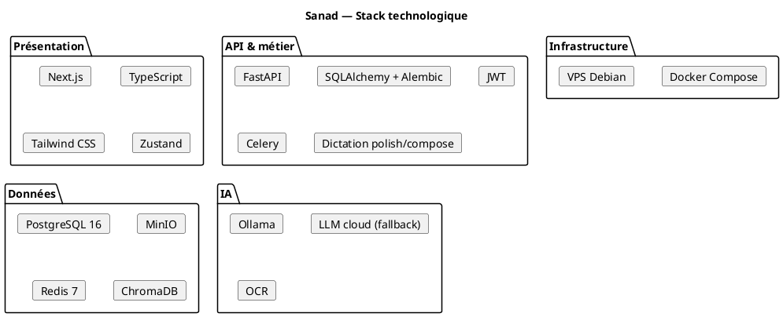
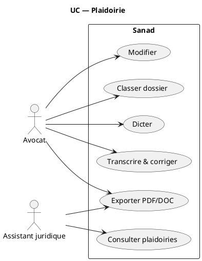
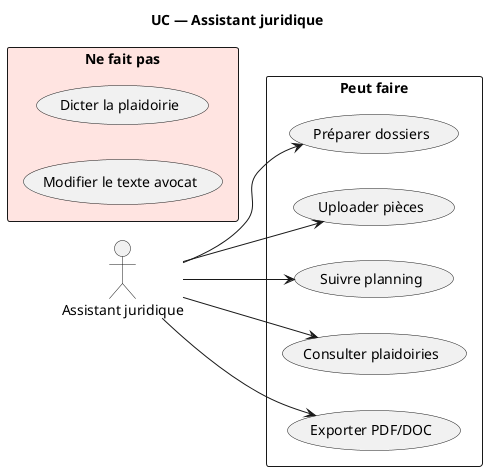

# Codes PlantUML — Sanad (à copier / prévisualiser)

Ouvre chaque fichier `.puml` dans Cursor (extension PlantUML)  
ou colle le code sur https://www.plantuml.com/plantuml/uml

| Fichier | Diagramme |
|---------|-----------|
| `20-architecture-principale.puml` | Architecture principale |
| `21-stack-technologique.puml` | Stack technologique |
| `22-cas-utilisation-plaidoirie.puml` | UC Plaidoirie (cœur) |
| `23-cas-utilisation-assistant.puml` | UC Assistant juridique |
| `24-deploiement-docker.puml` | Déploiement Docker / VPS |

Les anciens fichiers `14-` à `19-` restent disponibles ; **préférer 20–24** (alignés produit actuel : plaidoirie, sans chat au centre).

---

## 1. Architecture principale

---

## 2. Stack technologique

---

## 3. Cas d’utilisation — Plaidoirie

---

## 4. Cas d’utilisation — Assistant

